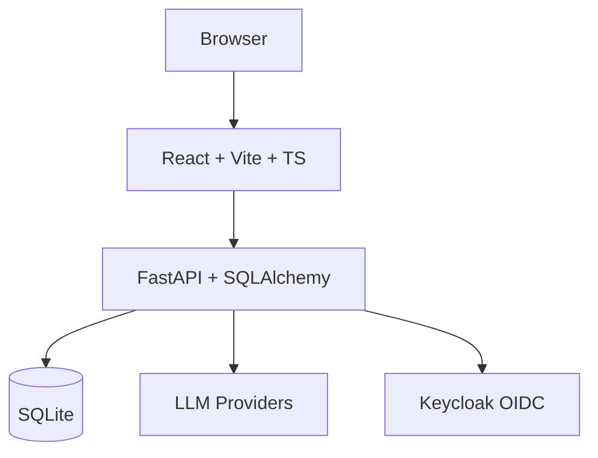

# Orbit Observatory

> Work in progress. This checkpoint may be incomplete or fail tests. See PLAN.md and STATUS.md before use.


The open-source app everyone uses to manage agents at work.

## Quick Start

### Prerequisites
- Docker and Docker Compose
- Node.js 24 (for local frontend development)
- Python 3.12 (for local backend development)

### Using Docker Compose (Recommended)
```bash
docker compose up --build
```
- Frontend: http://localhost:5173
- Backend API: http://localhost:8000
- API Docs: http://localhost:8000/docs

### Local Development

#### Backend
```bash
cd backend
python3 -m venv .venv
.venv/bin/pip install -r requirements.txt
.venv/bin/uvicorn app.main:app --reload --port 8000
```

#### Frontend
```bash
cd frontend
npm install
npm run dev
```

## Testing

### Backend Tests
```bash
cd backend
.venv/bin/pytest app/tests -v
```

### Frontend Tests
```bash
cd frontend
npm test
```

## Project Structure
```
orbit-observatory/
├── backend/
│   ├── app/
│   │   ├── api/          # API routes
│   │   ├── core/         # Configuration, security
│   │   ├── db/           # Database session, models
│   │   ├── models/       # SQLAlchemy models
│   │   ├── services/     # Business logic
│   │   ├── tests/        # Pytest tests
│   │   └── main.py       # FastAPI entrypoint
│   ├── requirements.txt
│   └── Dockerfile
├── frontend/
│   ├── src/
│   │   ├── api/          # API client
│   │   ├── components/   # React components
│   │   ├── hooks/        # Custom hooks
│   │   ├── pages/        # Page components
│   │   ├── types/        # TypeScript types
│   │   ├── App.tsx       # Root component
│   │   └── main.tsx      # Entry point
│   ├── package.json
│   ├── tsconfig.json
│   ├── vite.config.ts
│   └── Dockerfile
├── docker-compose.yaml
├── feature-plan.json
├── PLAN.md
└── README.md
```

## Architecture



## Features (Planned)
- **Agent Management**: Create, configure, and monitor AI agents
- **Workflow Execution**: Define and run multi-agent workflows as DAGs
- **Observability**: Real-time metrics, logs, and execution tracing
- **Authentication**: OIDC via Keycloak with SAML broker support

## API Endpoints
- `GET /api/v1/health` - Application health
- `GET /api/v1/health/db` - Database health

## Configuration
Environment variables (`.env`):
- `DATABASE_URL` - SQLite database path (default: `sqlite+aiosqlite:///./data/orbit.db`)
- `CORS_ORIGINS` - Allowed CORS origins
- `SECRET_KEY` - JWT signing key
- `LLM_PROVIDER` - LLM provider type
- `LLM_MODEL` - Model name
- `LLM_BASE_URL` - Custom base URL
- `LLM_API_KEY` - API key (server-side only)

## License
MIT License - Copyright (c) 2024 Alan Vo <alanvo@gmail.com>